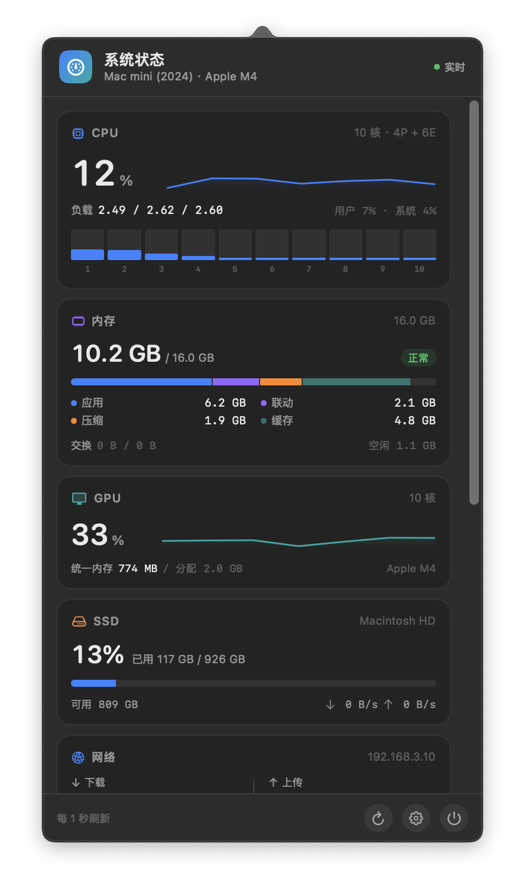
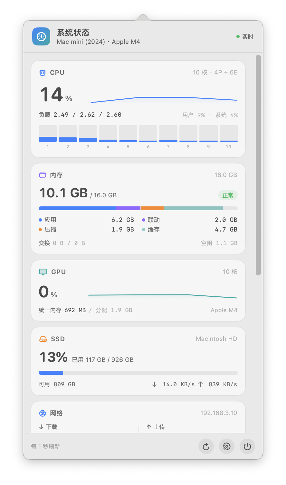
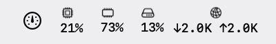
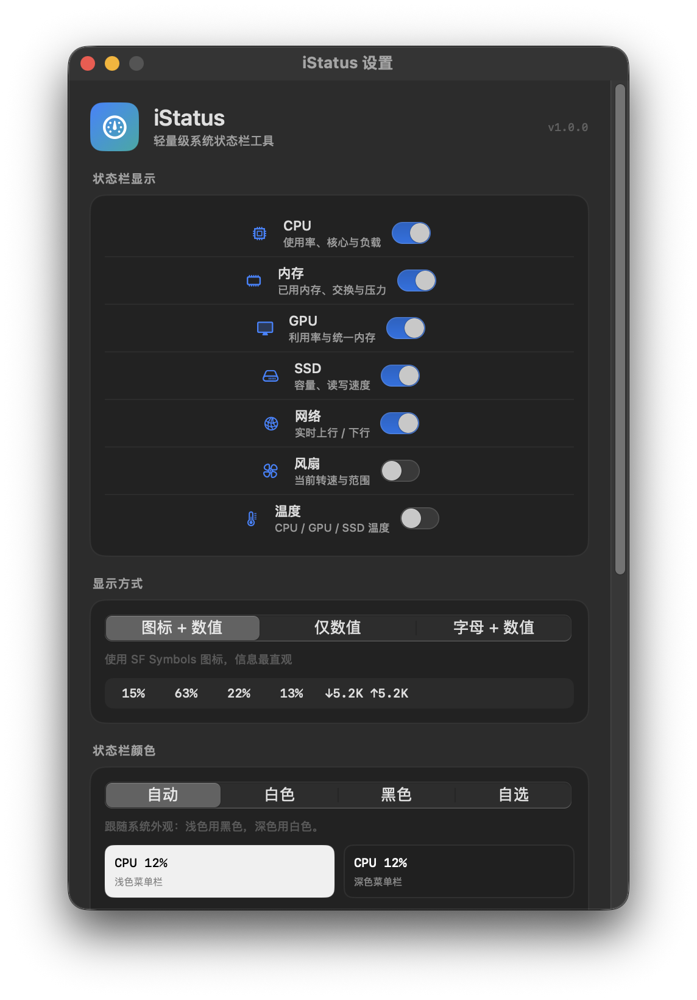
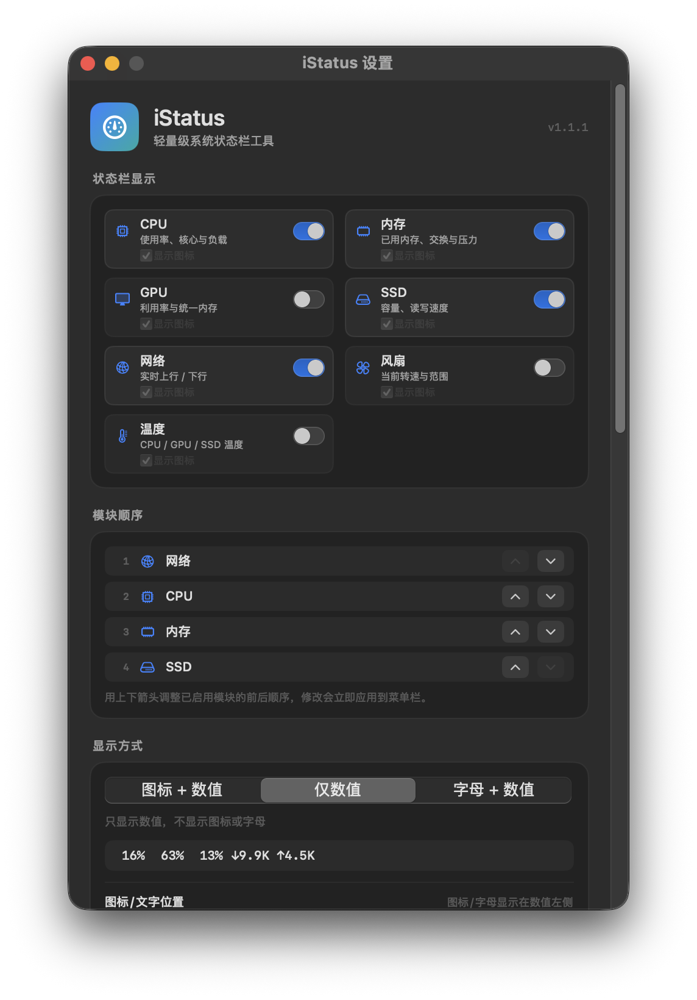
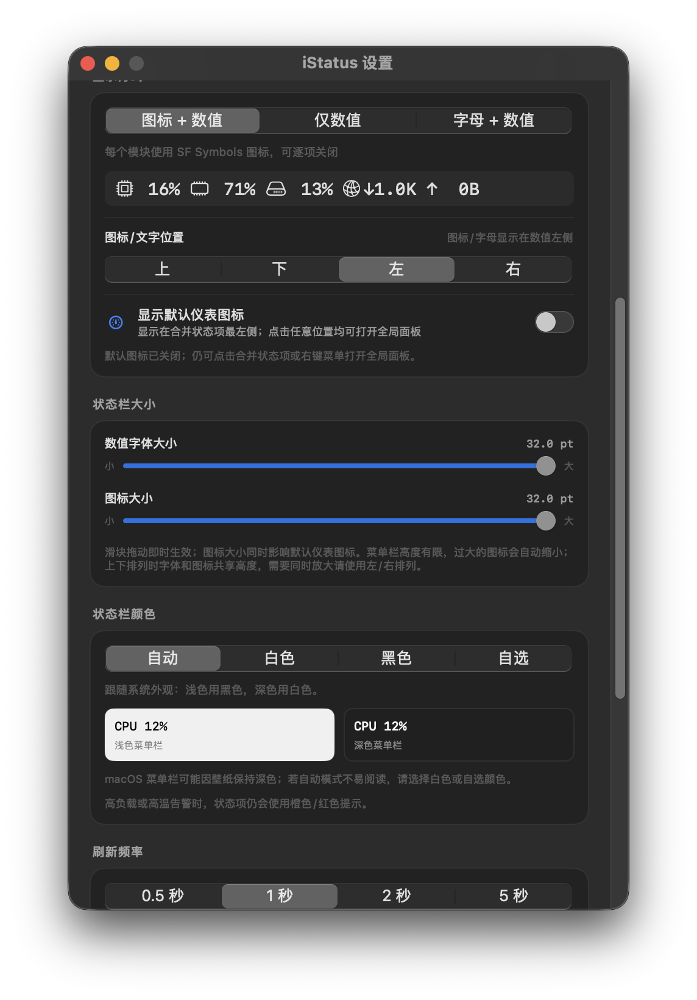

# iStatus

一个使用 macOS 原生 API 编写的极轻量系统状态栏工具。纯 Swift / SwiftUI / AppKit / IOKit，无第三方依赖、无后台守护进程、无 root 权限、不联网。

| 深色面板 | 浅色面板 |
| --- | --- |
|  |  |

| 深色菜单栏 | 浅色菜单栏 |
| --- | --- |
|  |  |







## 功能

- **合并为单个状态栏项**：所有已启用模块共享一个状态项，点击任意位置即可打开面板，不再为每个模块单独占用菜单栏位置。
- **状态栏模块可自定义**：CPU、内存、GPU、SSD、网络、风扇、温度逐项开关，设置页采用两列开关布局；每个模块还可单独选择是否显示图标/字母。
- **模块顺序可调**：在设置页用上下箭头调整已启用模块在合并项中的前后顺序，修改立即生效并保存。
- **三种显示方式**：`图标 + 数值`、`仅数值`、`字母 + 数值`。
- **图标/文字四向排列**：图标或字母可放在数值的上、下、左、右，合并项宽度随布局自动调整。
- **字体/图标大小可调**：设置页用滑块调整数值字体和图标大小（最大 32 pt），拖动即时生效；图标超出菜单栏可用高度时会自动缩小，上下排列时字体与图标也会互相让位。
- **紧凑且不抖动**：数值使用固定宽度字符串，刷新时不会左右跳动；合并项只在模块开关、显示方式或位置变化时调整长度。
- **默认仪表图标可关闭**：全局入口图标位于合并项最左侧，可在设置中隐藏；隐藏后仍可点击合并项或右键打开面板与设置。
- **状态栏颜色可选**：自动（跟随系统外观）、白色、黑色、自选颜色；图标和数值使用同一颜色。高负载/高温告警时仍会使用橙色/红色提示。
- **全局面板**：点击合并后的状态栏项，打开可滚动的实时面板。
- **CPU**：总体使用率、用户/系统占比、每核心柱状图、1/5/15 分钟负载。
- **内存**：已用/总量、应用/联动/压缩/缓存/空闲、交换空间、内存压力。
- **GPU**：利用率、统一内存占用与分配、GPU 核心数。
- **SSD**：容量与可用空间、实时读写速度（来自 IOKit 累计计数器）。
- **网络**：主接口、IPv4、实时上下行、累计收发流量、迷你趋势图。
- **风扇与温度**：风扇当前/最低/最高转速；CPU、GPU、SSD 温度；可展开查看全部 SMC 传感器。
- **开机自启动**：使用 macOS 13+ 的 `SMAppService`，无需 LaunchAgent 或特权助手。可在设置中开启/关闭，并显示待批准状态。
- **自动跟随浅色/深色外观**：自动模式按系统浅色/深色外观使用黑色/白色，系统外观切换时即时重绘。菜单栏自身可能因深色壁纸保持深色，此时可在设置中改选白色或自选颜色。全局面板使用语义色，始终跟随系统外观。
- **低资源占用**：默认 1 秒采样；面板关闭时物理 footprint 约 23 MB，打开面板约 44 MB。6 个模块常驻时约 3% 单核 CPU（10 核 M4 上约 0.3% 整机），关闭部分模块或降低刷新频率会更低。

## 系统要求

- macOS 13.0 或更高版本
- 在目标 Mac 上使用 Xcode 16+ / Swift 6 工具链构建
- 风扇/温度功能依赖 AppleSMC；无风扇的 Mac（如 MacBook Air）会显示“未检测到风扇”，温度传感器仍可用
- 未启用 App Sandbox（SMC / IOKit 访问需要）

验证环境：Mac mini (2024)，Apple M4，macOS 27.2，风扇 1000 RPM，27 个温度传感器。

## 构建与运行

```bash
git clone <repo> istatus
cd istatus

# 构建 release 版 .app，输出到 dist/iStatus.app
make app

# 运行
make run

# 生成图标（可选，构建脚本在缺少图标时会自动生成）
make icon

# 打印一次完整采样，便于验证数据源
make dump
```

也可以直接使用脚本：

```bash
./scripts/build.sh release
open dist/iStatus.app
```

### 安装到“应用程序”

```bash
make install
```

该命令会把 `dist/iStatus.app` 复制到 `/Applications/iStatus.app` 并启动。**建议先安装到“应用程序”再开启开机自启动**，这样登录项指向的路径更稳定；如果从 `dist/` 直接注册，移动 app 后登录项可能失效。

### 代码签名

构建脚本使用 ad-hoc 签名（`codesign --sign -`），足以在本机使用和注册 `SMAppService`。如果要分发给其他用户，请改用 Developer ID 签名并公证：

```bash
codesign --force --deep --options runtime --sign "Developer ID Application: ..." dist/iStatus.app
```

## 使用

- **左键点击**合并后的状态栏项：打开全局面板。
- **右键点击**合并项：打开快捷菜单（全局面板 / 设置 / 退出）。
- 在“状态栏显示”中可逐项开关模块，并单独控制每个模块是否显示图标/字母。
- 在“显示方式”中可选择图标/文字位于数值的上、下、左、右，以及是否显示最左侧的默认仪表图标。
- 设置窗口：面板右下角齿轮，或右键菜单“设置…”，或主菜单 `iStatus › 设置…`（`⌘,`）。
- 退出：面板右下角电源按钮、右键菜单，或 `⌘Q`。

### 设置项

| 设置 | 说明 |
| --- | --- |
| 状态栏显示 | 两列开关，逐项开启 CPU、内存、GPU、SSD、网络、风扇、温度；每个模块可单独隐藏图标/字母 |
| 模块顺序 | 用上下箭头调整已启用模块在菜单栏中的前后顺序 |
| 显示方式 | 图标 + 数值 / 仅数值 / 字母 + 数值 |
| 图标/文字位置 | 上 / 下 / 左 / 右；控制图标或字母相对数值的位置 |
| 数值字体大小 | 滑块 7.0–32.0 pt，默认 9.0 pt，步进 0.5 pt |
| 图标大小 | 滑块 6.0–32.0 pt，默认 8.0 pt；默认仪表图标按比例缩放，超出菜单栏高度时自动缩小 |
| 默认仪表图标 | 显示或隐藏合并项最左侧的全局入口图标 |
| 状态栏颜色 | 自动（跟随系统）/ 白色 / 黑色 / 自选颜色 |
| 刷新频率 | 0.5 / 1 / 2 / 5 秒；1 秒为推荐值 |
| 温度单位 | 摄氏度 / 华氏度 |
| 开机自启动 | `SMAppService` 登录项开关，并显示“需要批准”等状态 |

所有设置保存在 `UserDefaults`（`com.linimbus.istatus.config.v1`），不使用配置文件或数据库。

## 实现原理

| 指标 | 原生 API |
| --- | --- |
| CPU | `host_processor_info(PROCESSOR_CPU_LOAD_INFO)`、`getloadavg` |
| 内存 | `host_statistics64(HOST_VM_INFO64)`、`sysctl vm.swapusage`、`kern.memorystatus_vm_pressure_level` |
| GPU | IOKit `IOAccelerator` → `PerformanceStatistics`（`Device Utilization %`、`In use system memory`） |
| SSD | `URLResourceValues` 容量 + IOKit `IOBlockStorageDriver` 的 `Statistics` 累计读写字节 |
| 网络 | `sysctl(NET_RT_IFLIST2)` 64 位计数器 + `SCDynamicStore` 主接口 + `getifaddrs` IPv4 |
| 风扇/温度 | AppleSMC 用户客户端；`FNum`/`F0Ac`/`F0Mn`/`F0Mx`，以及按芯片型号匹配的 `Tp/Te/Tf/Tg/TH/Tm` 温度键 |
| 开机自启动 | `SMAppService.mainApp.register()/unregister()` |
| 状态栏 | 自绘单个合并 `NSStatusItem`（多模块分段、四向图标布局、固定宽度、可控文字/图标颜色）+ `NSPopover` + SwiftUI 面板 |
| 外观 | `NSColor.labelColor` 等动态语义色；KVO 观察 `NSApp.effectiveAppearance`，并监听 `AppleInterfaceThemeChangedNotification` |

SMC 读取只使用公开的 IOKit 用户客户端调用，不需要 root，也不需要安装内核扩展或特权 helper。温度键按芯片代际匹配（M1/M2/M3/M4/M5/M6 及 Intel 的部分常见键），启动时探测一次可用键，之后只读取存在的传感器。

## 资源占用

- 物理 footprint（`footprint -p <pid>`）：面板关闭约 23 MB，打开约 44 MB
- RSS 包含共享框架，`ps` 显示 90–130 MB 属于正常现象
- 空闲 CPU：6 个模块 + 1 秒刷新时约 3% 单核（10 核 M4 上约 0.3% 整机）
- 只保留 CPU/内存/网络/温度时的对照：约 2.5% 单核；只保留 CPU 时约 1.6% 单核
- 每次采样约读取 27 个 SMC 键，耗时约 4–5 ms
- 不发起任何网络请求；网络模块只读取本机接口计数器
- 面板关闭时不渲染 SwiftUI 视图，仅更新合并状态栏项的绘制内容

如果更在意续航，可以在设置中把刷新频率调为 2 秒或 5 秒，并关闭不常看的模块。

## 开发者调试

```bash
APP=dist/iStatus.app/Contents/MacOS/iStatus

# 完整采样并退出（不启动 UI）
$APP --dump

# 启动后自动打开面板或设置（截图/布局调试）
$APP --show-panel
$APP --show-settings

# 强制应用外观（面板/设置窗口；自动颜色也会跟随此调试值）
$APP --appearance light
$APP --appearance dark

# 测试 SMAppService 登录项，可随时注销
# 注意：登录项相关命令必须从 .app 包内的可执行文件运行
$APP --login-status
$APP --login-enable
$APP --login-disable
```

项目结构：

```
Sources/iStatus/
  main.swift                 入口、CLI 调试参数
  App/                       AppDelegate、StatusBarController、设置窗口
  Model/                     数据模型、设置、SystemMonitor、系统信息
  Providers/                 CPU/内存/GPU/SSD/网络/SMC/温度采集
  Support/                   格式化、sysctl、诊断输出
  UI/                        DashboardView、SettingsView、公共组件
Resources/                   Info.plist、AppIcon.icns
Tools/make-icon.swift        纯 CoreGraphics 图标生成器
scripts/                     build.sh、make-icon.sh
```

## 故障排查

**状态栏没有出现**
- 锁屏/登录界面不会显示第三方状态栏项，解锁后才会出现。
- 确认运行的是 `.app` 包，而不是 `.build/.../iStatus` 裸二进制（裸二进制也能运行，但没有图标和 `SMAppService`）。
- 确认 `LSUIElement` 生效：应用不会出现在 Dock，只在菜单栏。
- 如果菜单栏太拥挤，关闭几个模块或改用“仅数值”。
- 如果“默认仪表图标”已关闭且所有模块也关闭，状态栏将没有任何入口；可重新打开 iStatus 后在设置中恢复。

**风扇/温度显示“—”**
- 无风扇 Mac 没有风扇数据，这是正常的。
- SMC 键位随芯片/机型变化；先运行 `--dump` 查看 `传感器` 列表。
- 如果某个 SMC 键不存在，应用会自动跳过，不会报错。

**GPU 显示“—”**
- 部分 Intel 核显/独显配置的 `IOAccelerator` 不提供 `Device Utilization %`。CPU/内存/SSD/网络仍会正常显示。

**开机自启动无法开启**
- 先把 app 放到 `/Applications`，再开启。
- 如果状态显示“需要批准”，到“系统设置 › 通用 › 登录项与扩展”中允许 iStatus。
- 如果注册抛错，设置页会显示系统返回的具体错误。

**外观没有跟随系统**
- 应用使用动态语义色，并在 `NSApp.effectiveAppearance` 变化时重建菜单栏标题。
- 如果使用的是 `--appearance` 调试参数，请退出后正常启动。

**无法读取 SMC**
- 不要开启 App Sandbox；SMC 用户客户端在沙盒中不可用。
- 某些企业安全策略/内核扩展可能拦截 IOKit；可先用 `--dump` 验证。

## 已知限制

- 只读监控：不提供风扇调速、进程列表、电池统计或历史持久化。
- SMC 温度键覆盖 M1–M6 与 Intel 的常见键位，但不同机型仍可能有差异；缺失时自动跳过。
- GPU 利用率依赖 `IOAccelerator` 的 `PerformanceStatistics`，部分显卡不提供。
- 为保证数值变化时布局稳定，每个模块预留固定宽度的数值区域，合并项只在模块开关、显示方式、图标/文字位置或字号变化时调整长度；仍可用“仅数值”、隐藏图标或关闭不常看的模块进一步节省空间。
- 菜单栏可用高度约 30 pt，32 pt 字体可完整显示；图标会根据实际可用高度自动缩放，上下排列时字体与图标共享高度，需要同时放大两者可使用左/右排列。
- 本项目使用 ad-hoc 签名，适合本机自用；对外分发请使用 Developer ID 并公证。
- 构建脚本生成当前机器架构的二进制（本机为 arm64）；在 Intel Mac 上请在目标机器重新构建。
